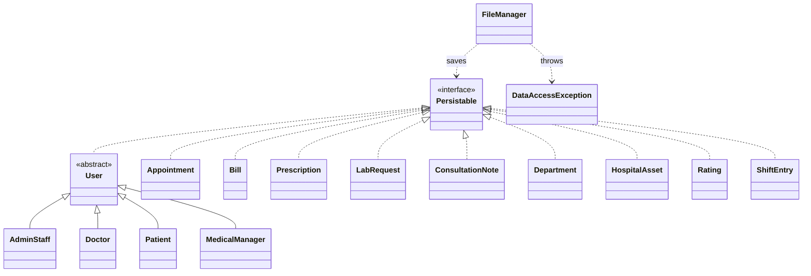

# Hospital Management System

An object-oriented Java desktop application (Swing) for managing hospital
operations: users, doctor assignments, appointments, consultations,
prescriptions, billing, lab requests, shift rosters and hospital assets.
Built as a group project for Object-Oriented Development with Java (OODJ)
at Asia Pacific University (APU).

## User roles
- **Admin** - manage users, assign doctors, manage hospital assets, set rates and insurance, handle lab requests, edit own profile
- **Doctor** - view profile, write consultation notes, issue prescriptions, create lab / imaging requests
- **Patient** - register, book appointments, view medical history, rate a visit
- **Medical Manager** - manage departments and assessment types, plan the shift roster, view reports

## My contribution
I built the **Admin** module: `AdminStaff` and `AdminDashboard`, with these screens:
Manage Users, Assign Doctors, Hospital Assets, Rates & Insurance, Lab Requests and My Profile.

## OOP concepts used
- **Abstraction and inheritance**: abstract class `User` with subclasses `AdminStaff`, `Doctor`, `Patient` and `MedicalManager`
- **Interface**: `Persistable` is implemented by `User` and by records such as `Appointment`, `Bill`, `Prescription`, `LabRequest`, `Department` and `HospitalAsset`
- **Generics**: `FileManager.saveEntities(path, List<T extends Persistable>)` saves any entity type
- **Custom exception**: `DataAccessException` for file storage errors
- **Reusable UI components**: `NavButton`, `UITheme`

## Tech
- Java 17, Swing GUI
- File-based storage in `data/` (plain text files, no database)
- Password hashing in `PasswordUtil`

## Run
1. Clone the repo and open it in IntelliJ IDEA
2. Run the main class `src/Main.java`

## Class diagram

## Project structure
| Path | Purpose |
|------|---------|
| `src/Main.java` | Entry point |
| `src/LoginFrame.java`, `RegisterFrame.java` | Login and registration screens |
| `src/AdminDashboard.java`, `DoctorDashboard.java`, `PatientDashboard.java`, `MedicalManagerDashboard.java` | Dashboard for each role |
| `src/User.java`, `AdminStaff.java`, `Doctor.java`, `Patient.java`, `MedicalManager.java` | User model |
| `src/Appointment.java`, `Bill.java`, `Prescription.java`, `LabRequest.java`, `ConsultationNote.java`, `Rating.java`, `ShiftEntry.java` | Hospital records |
| `src/Department.java`, `HospitalAsset.java`, `ConsultationConfig.java`, `AssessmentType.java`, `VitalsGrader.java` | Hospital setup and configuration |
| `src/FileManager.java`, `Persistable.java`, `DataAccessException.java`, `PasswordUtil.java` | Storage and security |
| `src/UITheme.java`, `NavButton.java` | Shared UI styling |
| `data/` | Sample data files (all fictional) |

## Team
- [@tanmay1802-art](https://github.com/tanmay1802-art) - Admin module
- [@littleboyvoldemort](https://github.com/littleboyvoldemort) - Doctor module
